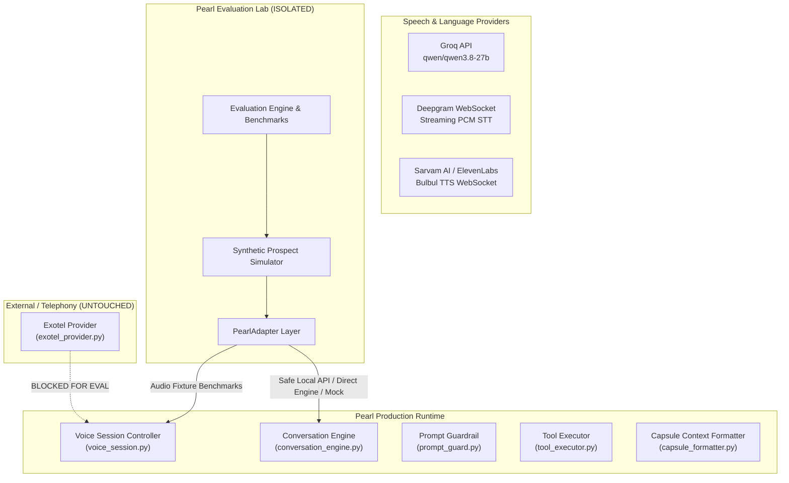
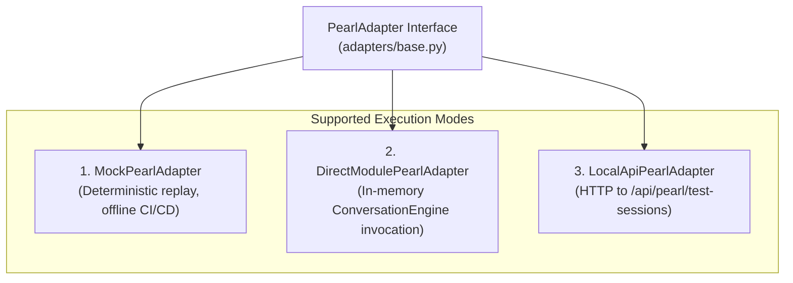

# Pearl AI: Architecture Discovery & Integration Boundaries Report

**Project:** Pearl Evaluation Lab  
**Date:** October 31, 2026  
**Audited Target:** ClozFlow / Pearl AI Autonomous Sales Agent  
**Document Status:** Complete Architecture Discovery (Phase 0)

---

## 1. Executive Architecture Findings

ClozFlow's autonomous voice agent (`Pearl`) operates as a cascaded, event-driven speech and intelligence stack built on top of FastAPI, SQLAlchemy/SQLite, Groq LLM streaming, Deepgram STT, Sarvam AI / ElevenLabs TTS, and Exotel telecom integration.



---

## 2. Relevant Existing Modules & Interfaces

### 2.1. Conversation Orchestration & Core Intelligence
* **Module:** [`backend/services/pearl/conversation_engine.py`](file:///D:/devlopment/ClozFLow/backend/services/pearl/conversation_engine.py)
* **Class:** `ConversationEngine`
* **Constructor:**
  ```python
  ConversationEngine(
      objective: str,
      lead_context: Dict[str, Any],
      system_prompt_override: Optional[str] = None
  )
  ```
* **Key Methods:**
  - `add_turn(speaker: str, text: str) -> None`: Appends turns (`prospect` or `assistant`), sanitizes input, and limits history to the last 10 turns.
  - `generate_response_stream() -> AsyncGenerator[str, None]`: Streams tokens asynchronously from Groq API (`qwen/qwen3.8-27b`).
  - Pre-LLM Guardrail: Executes `detect_prompt_injection()` on every incoming prospect utterance, deflecting jailbreaks and DAN attacks in-character.
* **Evaluation Suitability:** **Extremely High.** Can be evaluated in-memory with custom `lead_context` and `objective` without writing to any production database or dialing phones.

### 2.2. Turn Lifecycle, VAD & Barge-In Controller
* **Module:** [`backend/services/pearl/voice_session.py`](file:///D:/devlopment/ClozFLow/backend/services/pearl/voice_session.py)
* **Class:** `PearlVoiceSession`
* **States:** `IDLE`, `LISTENING`, `USER_TURN_PENDING`, `THINKING`, `SPEAKING`, `INTERRUPTED`, `CLOSED`
* **Generation Invariant:** Increments `generation_id` on each AI turn. Any audio or text chunks arriving from older generation IDs after prospect barge-in are immediately rejected.
* **Evaluation Suitability:** Ideal for evaluating turn management, barge-in detection, and interruption metrics using pre-recorded or synthetic audio fixtures.

### 2.3. Knowledge & Capsule Structure
* **Modules:** 
  - [`backend/models.py`](file:///D:/devlopment/ClozFLow/backend/models.py) (`Capsule` table: company & product capsules)
  - [`backend/models_knowledge.py`](file:///D:/devlopment/ClozFLow/backend/models_knowledge.py) (`KnowledgeSource`, `KnowledgePage`, `KnowledgeFact`, `KnowledgeChunk`)
  - [`backend/utils/capsule_formatter.py`](file:///D:/devlopment/ClozFLow/backend/utils/capsule_formatter.py) (`format_capsule_context(capsule, db)`)
* **Format Structure:** Merges company positioning, brand tone, product specifications, pricing tiers, and objection battlecards into structured context strings.
* **Evaluation Suitability:** The lab can evaluate factual adherence, retrieval accuracy, and groundedness by passing controlled benchmark capsules into the engine.

### 2.4. Tool Execution & Policy Engine
* **Modules:**
  - [`backend/services/pearl/tool_executor.py`](file:///D:/devlopment/ClozFLow/backend/services/pearl/tool_executor.py) (`ToolExecutor`)
  - [`backend/services/pearl/policy_engine.py`](file:///D:/devlopment/ClozFLow/backend/services/pearl/policy_engine.py) (`PolicyEngine`)
* **Tool Set:** `get_lead_context`, `get_capsule_context`, `update_crm`, `book_calendar`, `schedule_callback`.
* **Policy Guard:** Validates actions before execution, logging events and raising `PolicyViolation` on unauthorized operations.
* **Evaluation Suitability:** Evaluates tool selection accuracy, argument schemas, and duplicate action prevention.

### 2.5. Speech & Voice Pipeline
* **Speech-to-Text (STT):** Deepgram WebSocket streaming (`deepgram-sdk`) via `/api/pearl/test-sessions/{id}/voice`.
* **Text-to-Speech (TTS):** 
  - `SarvamTTSProvider` in [`backend/services/pearl/providers/tts.py`](file:///D:/devlopment/ClozFLow/backend/services/pearl/providers/tts.py#L111) connecting to `wss://api.sarvam.ai/text-to-speech/ws` with Indian base voices (`shubh`, `ritu`, `aditya`, etc.).
  - `ElevenLabsTTSProvider` as fallback.
* **Chunking:** `PhraseChunker` in [`backend/services/pearl/phrase_chunker.py`](file:///D:/devlopment/ClozFLow/backend/services/pearl/phrase_chunker.py) for natural punctuation and clause-boundary streaming.

### 2.6. Telephony Integration
* **Module:** [`backend/services/pearl/providers/exotel_provider.py`](file:///D:/devlopment/ClozFLow/backend/services/pearl/providers/exotel_provider.py)
* **Integration:** Exotel outbound call connect payload connecting to `PEARL_PUBLIC_URL` bidirectional audio stream.
* **CRITICAL EVALUATION POLICY:** **Completely blocked from evaluation**. The evaluation lab must never initiate real outbound telephony calls.

---

## 3. Available Interfaces for Pearl Evaluation Lab

The evaluation lab interacts with Pearl through a unified, isolated adapter layer supporting three distinct modes:



1. **`MockPearlAdapter` (Offline / Deterministic):**
   - Replays canned responses, scripted dialogue, or rule-based replies.
   - Requires zero external API keys and runs instantaneously in unit test and CI/CD environments.
2. **`DirectModulePearlAdapter` (In-Memory Engine):**
   - Directly instantiates `ConversationEngine(objective, lead_context, system_prompt_override)`.
   - Feeds turns and collects streaming tokens directly.
   - Completely bypasses SQLite and telecom infrastructure—zero side-effects on production state.
3. **`LocalApiPearlAdapter` (Test Session API):**
   - Connects over HTTP to a local ClozFlow server instance:
     - `POST /api/pearl/test-sessions`
     - `POST /api/pearl/test-sessions/{id}/chat`
     - `POST /api/pearl/test-sessions/{id}/end`
   - Uses ClozFlow's existing test session sandbox endpoints without altering any production routes.

---

## 4. Components That Must Remain Untouched

Under the **Critical Isolation Policy**, the following components are strictly out-of-bounds for modification by the evaluation lab:
- ❌ All routes in `backend/routers/`
- ❌ Production conversation engine code in `backend/services/pearl/`
- ❌ Knowledge base and crawler code in `backend/services/knowledge/`
- ❌ Exotel provider in `backend/services/pearl/providers/exotel_provider.py`
- ❌ Database models, migrations, and database files (`backend/hexagon.db`)
- ❌ Production `.env` credentials and configuration
- ❌ React frontend components in `frontend/src/`

---

## 5. Deletion & Isolation Verification Contract

The entire evaluation framework lives inside `./pearl-evaluation-lab`. Deleting the directory:
```bash
rm -rf ./pearl-evaluation-lab
```
will leave ClozFlow completely intact, with zero broken imports, zero lingering database artifacts, and zero modified production files.
